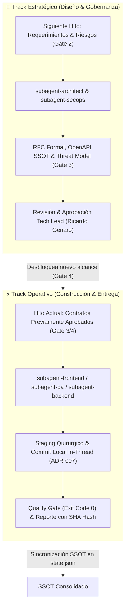

# Puertas de Aprobación Decisional (Gateways) - Genaryth Orchestrator

**Principio Rector:** La IA nunca avanza entre etapas sin la aprobación explícita de Ricardo Genaro (Tech Lead). Las actividades operativas se ejecutan únicamente dentro del alcance autorizado de una puerta abierta.

---

## 🚪 GATE 1: BUSINESS_REVIEW (Puerta de Oportunidad & Negocio)
* **Objetivo:** Asegurar que se comprende a fondo el problema del cliente, la viabilidad comercial y el alcance macro antes de definir especificaciones funcionales.
* **Entradas Requeridas:** Idea inicial, restricciones del cliente, objetivos estratégicos.
* **Subagentes Involucrados:** `orchestrator`, `subagent-process` (modelado de flujo As-Is/To-Be).
* **Entregable Obligatorio:** Propuesta de Negocio Estructurada (`docs/BUSINESS_OPPORTUNITY.md` o sección en `docs/CONTEXTO_MAESTRO.md`).
* **Criterios de Calidad:**
  - Problema y dolor real identificados con claridad.
  - Usuarios y partes interesadas mapeados.
  - Alternativas de solución evaluadas desde perspectiva de valor/costo.
  - Supuestos, riesgos y preguntas críticas pendientes.
* **Pregunta de Decisión al Tech Lead:** *¿Se aprueba el alcance de negocio y la propuesta estratégica para proceder con el levantamiento de requerimientos detallados?*
* **Condición de Bloqueo:** PROHIBIDO redactar Historias de Usuario o diseñar arquitectura técnica si Gate 1 no está en estado `APPROVED`.

---

## 🚪 GATE 2: REQUIREMENTS_REVIEW (Puerta de Requerimientos & Criterios)
* **Objetivo:** Definir con rigor qué necesita la solución, eliminando ambigüedades antes del diseño técnico.
* **Entradas Requeridas:** Propuesta de Negocio aprobada en Gate 1.
* **Subagentes Involucrados:** `subagent-po` (BDD/Gherkin), `subagent-process`.
* **Entregable Obligatorio:** Especificación Funcional (`docs/PRODUCT_SPEC_V1.md` o PRD).
* **Criterios de Calidad:**
  - Historias de Usuario estructuradas con formato formal.
  - Criterios de Aceptación bajo sintaxis BDD (*Given-When-Then*).
  - Reglas de negocio explícitas y casos límite (edge cases, errores, excepciones).
  - Requerimientos no funcionales (SLAs de latencia, seguridad, rendimiento, navegadores).
  - Alcance explícitamente incluido y excluido (In-Scope vs. Out-of-Scope).
* **Pregunta de Decisión al Tech Lead:** *¿Se aprueban los requerimientos funcionales y criterios de aceptación para proceder con el diseño de arquitectura y contratos?*
* **Condición de Bloqueo:** PROHIBIDO modelar bases de datos ni endpoints si Gate 2 no está en estado `APPROVED`.

---

## 🚪 GATE 3: ARCHITECTURE_REVIEW (Puerta de Arquitectura, Contratos & Seguridad)
* **Objetivo:** Establecer la arquitectura sólida de la solución y sellar los contratos de integración antes de escribir código.
* **Entradas Requeridas:** Requerimientos aprobados en Gate 2.
* **Subagentes Involucrados:** `subagent-architect`, `subagent-secops`, `subagent-uiux` (Design System).
* **Entregable Obligatorio:**
  - Especificación de Arquitectura de la Solución (`docs/ARCHITECTURE_SOLUTION.md`).
  - Catálogo y Contratos de API sellados (`docs/openapi.json` / `docs/API_CATALOG_V1.md`).
  - Modelos de Datos / DER relacional o esquemas NoSQL.
  - Registro de Decisiones de Arquitectura (ADRs) con alternativas evaluadas y pros/contras.
  - Threat Modeling preliminar y matriz de seguridad OWASP.
* **Criterios de Calidad:**
  - Separación de responsabilidades clara (Clean Architecture / Hexagonal).
  - Códigos de error HTTP, autenticación y autorización (RBAC) especificados.
  - Estrategia de resiliencia y manejo de fallos definida.
* **Pregunta de Decisión al Tech Lead:** *¿Se aprueba la arquitectura, el modelo de datos y los contratos de API sellados para proceder con la planificación del sprint?*
* **Condición de Bloqueo:** PROHIBIDO escribir controladores, servicios, páginas o componentes si Gate 3 no está en estado `APPROVED`.

---

## 🚪 GATE 4: PLAN_REVIEW (Puerta de Planificación & Autorización de Implementación)
* **Objetivo:** Convertir los requerimientos y la arquitectura en un plan de implementación priorizado y ejecutable, autorizando el alcance exacto a construir.
* **Entradas Requeridas:** Contratos de arquitectura aprobados en Gate 3.
* **Subagentes Involucrados:** `orchestrator`, `subagent-backend`, `subagent-frontend`, `subagent-devops`.
* **Entregable Obligatorio:** Tablero de Implementación (`docs/SPRINT_BOARD.md`).
* **Criterios de Calidad:**
  - Desglose granular de tareas técnicas con identificadores únicos (`BE-XX`, `FE-XX`, `OPS-XX`, `QA-XX`).
  - Dependencias entre tareas identificadas y ruta crítica definida.
  - Tareas paralelas identificadas para ejecución de subagentes.
  - Asignación explícita de subagentes por tarea con modelo LLM asignado.
  - Alcance autorizado delimitado (ej. "Autorizado únicamente el Sprint 1: Autenticación y Perfil").
* **Pregunta de Decisión al Tech Lead:** *¿Se aprueba el plan de implementación, la priorización y el alcance autorizado para iniciar la construcción?*
* **Condición de Bloqueo:** PROHIBIDO ejecutar tareas de código que no estén dentro del `authorized_scope` aprobado en Gate 4.

---

## 🚪 GATE 5: ACCEPTANCE_REVIEW (Puerta de Validación, Calidad & Aceptación)
* **Objetivo:** Demostrar con evidencias verificables que el incremento implementado cumple todos los criterios de aceptación y estándares de calidad antes de autorizar cualquier despliegue.
* **Entradas Requeridas:** Código implementado dentro del alcance autorizado en Gate 4.
* **Subagentes Involucrados:** `subagent-qa`, `subagent-secops`, `subagent-sre`.
* **Entregable Obligatorio:** Reporte de Validación y Evidencias (`docs/QA_ACCEPTANCE_REPORT.md`).
* **Criterios de Calidad:**
  - Evidencias duras de pruebas unitarias (100% pasando).
  - Evidencias de pruebas E2E (Playwright) y pruebas de estrés de UI (`break-ui`).
  - Reporte de análisis estático (linter, tipado TypeScript estricto, cero errores).
  - Auditoría de accesibilidad (a11y WCAG AA) y performance (Core Web Vitals).
  - Cero secretos expuestos y dependencias vulnerables auditadas.
* **Pregunta de Decisión al Tech Lead:** *¿Se aceptan los entregables y evidencias para autorizar el cierre del incremento o el paso a despliegue en cloud?*
* **Condición de Bloqueo:** PROHIBIDO realizar despliegues (`cdk deploy`, merge a ramas productivas) si Gate 5 no está en estado `APPROVED`.

---

## ⚡ Orquestación Dual-Track (Dual-Track Governance)

> [!IMPORTANT]
> **LOS GATEWAYS GOBIERNAN ENTREGABLES, NO PARALIZAN EL SQUAD EN CASCADA LINEAL.**
> El Orchestrator evalúa las dependencias técnicas de forma desacoplada para mantener un flujo continuo de alto rendimiento:

### Reglas Operativas del Dual-Track:
1. **Track Operativo (Momentum de Entrega):** Si un componente cuenta con contratos OpenAPI y modelos previamente aprobados (e.g. rediseño UI/UX de pantallas en `apps/web/`), el Orchestrator despacha a los especialistas operativos para avanzar sin fricción.
2. **Track Estratégico (Blindaje de Nuevos Dominios):** En paralelo, si el próximo incremento (e.g. arquitectura de webhooks y EDA en backend o nuevos stacks de CDK) involucra decisiones críticas, el Orchestrator asigna al Architect y SecOps la elaboración del RFC y Threat Modeling.
3. **Punto de Convergencia:** El Track Estratégico solo se convierte en código operativo cuando Ricardo Genaro otorga el `APPROVED` formal en el Gateway correspondiente.

